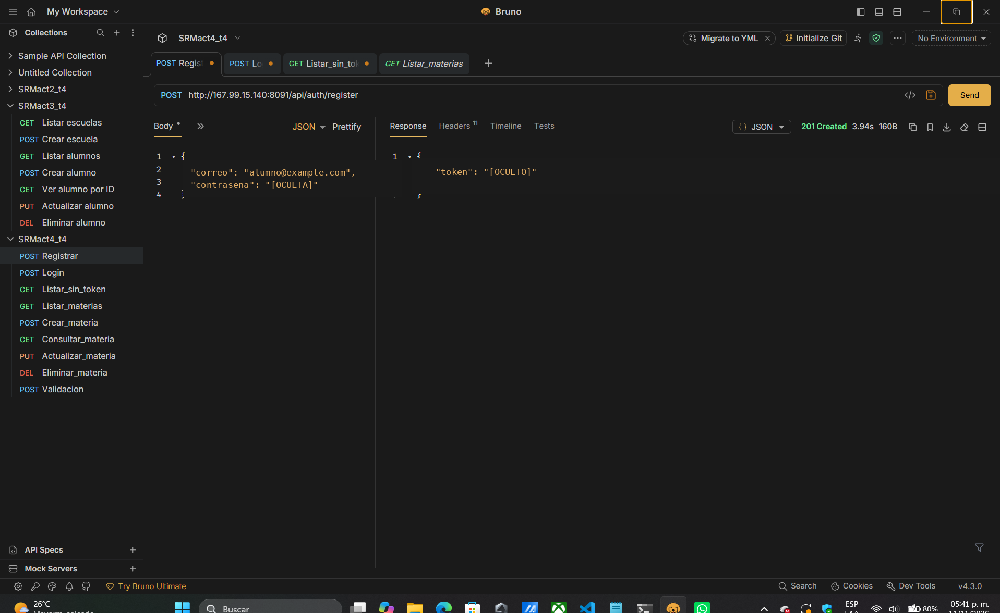
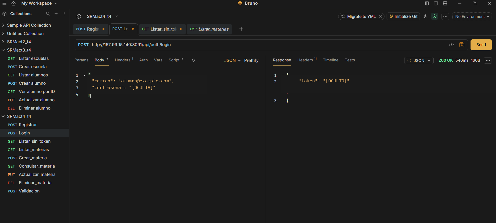
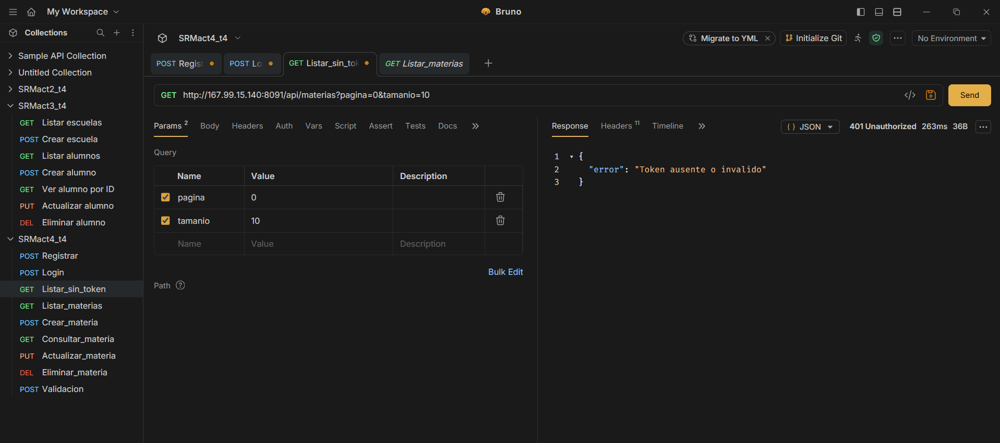
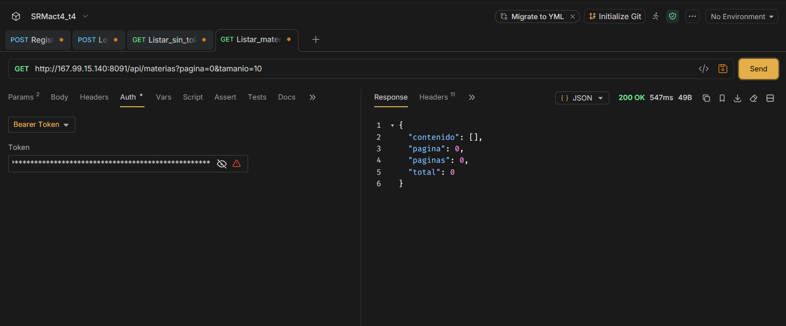
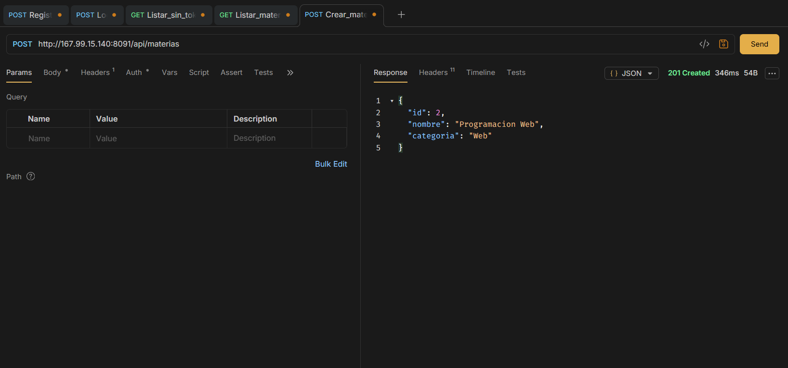
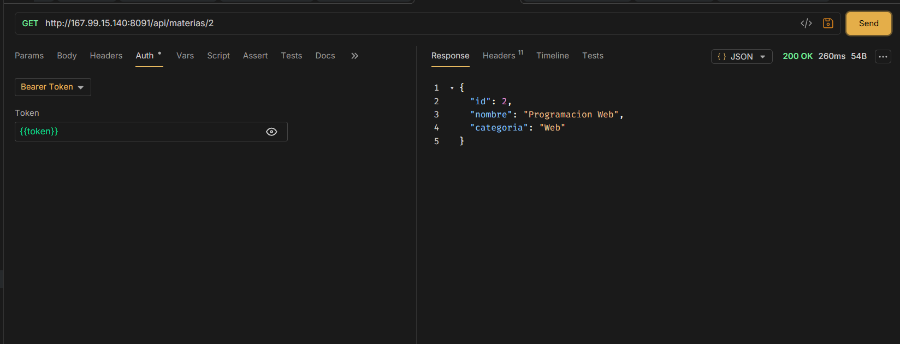
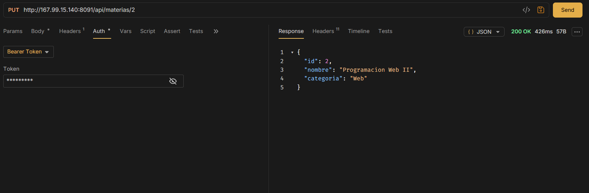
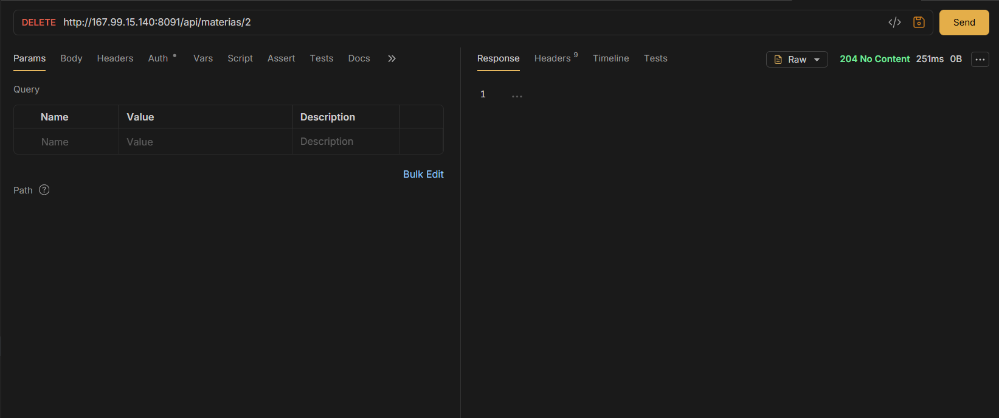
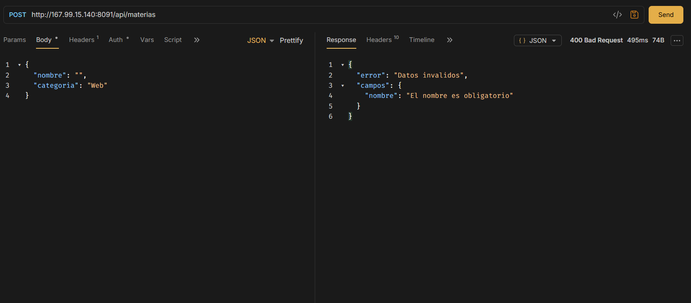

# SRMact4_t4 — API REST de materias con Spring Security y JWT

**Actividad 4 — Programación Web**  
**Estudiante:** Sandoval Reyes Miguel  
**Tecnología principal:** Java 17, Spring Boot y MySQL  
**Repositorio:** [miguelsandovalreyeskgll/SRMact4_t4](https://github.com/miguelsandovalreyeskgll/SRMact4_t4)

## 1. Descripción

API REST desarrollada con Spring Boot para la administración de materias mediante operaciones CRUD. Incluye registro e inicio de sesión, autenticación con tokens JWT, protección de rutas mediante Spring Security, validación de entradas con DTO y almacenamiento persistente en MySQL.

El proyecto no utiliza frontend ni vistas Thymeleaf. Todas las operaciones se realizan mediante peticiones HTTP y producen respuestas de API en formato JSON, salvo aquellas que no requieren cuerpo, como una eliminación exitosa (`204 No Content`). Las pruebas se documentan con la colección de **Bruno** incluida en el repositorio.

## 2. Tecnologías

- **Java 17** y **Spring Boot 4.1.2**.
- **Spring Web MVC** para los controladores REST.
- **Spring Security** para proteger las rutas.
- **JWT (HS256)** para autenticar las peticiones.
- **BCrypt** para almacenar contraseñas codificadas de forma segura.
- **Spring Data JPA / Hibernate** y **MySQL 8** para persistencia.
- **Bean Validation** (`@Valid`, `@NotBlank`, `@Email`, `@Size`) para validación.
- **Gradle** para compilación y ejecución.
- **Bruno** para pruebas y documentación de las peticiones.

## 3. Organización del proyecto

```text
SRMact4_t4/
├── bruno/
│   ├── environments/
│   ├── 01-Registrar.bru
│   ├── 02-Login.bru
│   └── ...
├── capturas/
│   ├── img1.png
│   ├── img2.png
│   └── ... img9.png
├── src/main/java/com/srm/act4/
│   ├── controlador/
│   │   ├── AuthController.java
│   │   ├── MateriaController.java
│   │   └── ErroresController.java
│   ├── dto/
│   ├── modelo/
│   ├── repositorio/
│   ├── seguridad/
│   ├── servicio/
│   └── Act4Application.java
├── src/main/resources/application.properties
├── build.gradle
├── gradlew.bat
└── README.md
```

| Componente | Responsabilidad |
|---|---|
| `AuthController` | Registro de usuarios e inicio de sesión. |
| `MateriaController` | Endpoints GET, POST, PUT y DELETE de materias. |
| `ErroresController` | Respuestas estructuradas ante errores y datos inválidos. |
| `MateriaDTO`, `RegistroDTO`, `LoginDTO`, `TokenDTO` | Transferencia y validación de datos. |
| `Materia`, `Usuario` | Entidades JPA asociadas a la base de datos. |
| `MateriaRepository`, `UsuarioRepository` | Operaciones de acceso a datos mediante JPA. |
| `MateriaService` | Lógica de consulta, registro, modificación y eliminación. |
| `SeguridadConfig` | Configuración de autenticación y autorización JWT. |
| `JwtService` | Generación de JWT firmados. |

## 4. Endpoints

**URL base del despliegue:** `http://167.99.15.140:8091`

| Método | Endpoint | Función | Autenticación | Respuesta exitosa |
|---|---|---|---|---|
| `POST` | `/api/auth/register` | Registrar usuario | No | `201 Created` |
| `POST` | `/api/auth/login` | Iniciar sesión | No | `200 OK` |
| `GET` | `/api/materias?pagina=0&tamanio=10` | Listar con paginación | JWT | `200 OK` |
| `GET` | `/api/materias/{id}` | Consultar una materia | JWT | `200 OK` |
| `POST` | `/api/materias` | Crear una materia | JWT | `201 Created` |
| `PUT` | `/api/materias/{id}` | Actualizar una materia | JWT | `200 OK` |
| `DELETE` | `/api/materias/{id}` | Eliminar una materia | JWT | `204 No Content` |

Se utiliza el encabezado `Authorization: Bearer <TOKEN_JWT>` para acceder a las rutas protegidas. El token contiene el identificador del usuario (`sub`, correo), la fecha de emisión (`iat`) y la expiración (`exp`); se firma con HS256 y tiene una vigencia configurada de **24 horas**.

### Ejemplos de peticiones

**Registrar usuario** — `POST /api/auth/register`

```json
{
  "correo": "alumno@example.com",
  "contrasena": "CONTRASENA_DE_PRUEBA"
}
```

**Iniciar sesión** — `POST /api/auth/login`

```json
{
  "correo": "alumno@example.com",
  "contrasena": "CONTRASENA_DE_PRUEBA"
}
```

**Crear materia** — `POST /api/materias`

```json
{
  "nombre": "Programacion Web",
  "categoria": "Web"
}
```

**Actualizar materia** — `PUT /api/materias/{id}`

```json
{
  "nombre": "Programacion Web II",
  "categoria": "Web"
}
```

El registro y el inicio de sesión devuelven un JWT. Las contraseñas almacenadas del usuario no se incluyen en las respuestas. El uso de un correo duplicado, un ID inexistente, un token ausente o datos inválidos produce la respuesta HTTP correspondiente (`409`, `404`, `401` o `400`).

## 5. Ejecución local

**Requisitos:** Java 17, MySQL 8 y Gradle Wrapper incluido en el repositorio.

Crear la base de datos:

```sql
CREATE DATABASE IF NOT EXISTS srmact4;
```

Definir `DB_USER`, `DB_PASSWORD` y `JWT_SECRET` como variables de entorno, sin colocar secretos en los archivos versionados. `JWT_SECRET` debe contener una clave aleatoria de al menos 32 bytes codificada en Base64. También se puede establecer `DB_URL` si la base de datos no utiliza la dirección predeterminada.

En CMD, desde la carpeta del proyecto:

```cmd
gradlew.bat bootRun
```

La aplicación utiliza por defecto el puerto **9084** en local, por lo que la URL base es `http://localhost:9084`. Las tablas de MySQL se administran a través de JPA conforme a la configuración del proyecto.

Para generar el ejecutable:

```cmd
gradlew.bat bootJar
```

## 6. Despliegue en VPS

La API fue desplegada en Ubuntu 24.04 con OpenJDK 17 y MySQL 8, separada de las actividades anteriores.

| Configuración | Valor |
|---|---|
| Servidor | VPS Ubuntu 24.04 |
| Puerto | `8091` |
| Carpeta del proyecto | `/opt/srmact4` |
| Archivo ejecutable | `SRMact4_t4-0.0.1-SNAPSHOT.jar` |
| Servicio de Linux | `srmact4.service` |
| Base de datos | `srmact4` (MySQL) |
| Configuración privada | Variables de entorno administradas en el VPS |

El servicio se configura mediante `systemd` para su administración y arranque automático. Durante las pruebas se confirmó que la aplicación respondió en el puerto `8091` sin afectar los servicios de las Actividades 1 y 2, que utilizan los puertos `8082` y `9082`, respectivamente.

> **Nota de seguridad:** el despliegue demostrado utiliza HTTP sin TLS. Para intercambiar credenciales por internet de forma segura se debe habilitar HTTPS; las pruebas sensibles pueden realizarse mediante un túnel SSH. No se incluyen contraseñas ni tokens reales en este repositorio.

## 7. Pruebas y evidencias con Bruno

La colección se encuentra en [`bruno/`](bruno/) e incluye las nueve solicitudes documentadas. Se realizaron pruebas directamente contra la API del VPS en el puerto `8091`.

### Evidencia 1. Registro de usuario — `201 Created`

Se realizó la petición `POST /api/auth/register`. La API aceptó el registro y devolvió un token JWT. El valor del token y la contraseña se ocultan en la captura publicada.



### Evidencia 2. Inicio de sesión — `200 OK`

La petición `POST /api/auth/login` autenticó al usuario y devolvió un JWT válido. El token y la contraseña se ocultan en la captura.



### Evidencia 3. Acceso sin JWT — `401 Unauthorized`

La consulta `GET /api/materias` sin token fue rechazada por Spring Security, que devolvió el mensaje de error correspondiente.



### Evidencia 4. Listado paginado — `200 OK`

La consulta autenticada `GET /api/materias?pagina=0&tamanio=10` devolvió una respuesta paginada. La colección estaba vacía antes de registrar la materia utilizada en las pruebas del CRUD.



### Evidencia 5. Creación de materia — `201 Created`

La petición `POST /api/materias` creó una materia con el nombre `Programacion Web` y la categoría `Web`. El servidor devolvió el identificador `2`.



### Evidencia 6. Consulta por ID — `200 OK`

La petición `GET /api/materias/2` recuperó correctamente la materia registrada.



### Evidencia 7. Actualización — `200 OK`

La petición `PUT /api/materias/2` modificó el nombre a `Programacion Web II`.



### Evidencia 8. Eliminación — `204 No Content`

La petición `DELETE /api/materias/2` eliminó el registro. La respuesta exitosa no incluyó cuerpo.



### Evidencia 9. Validación de entrada — `400 Bad Request`

Se envió una petición de creación con el campo `nombre` vacío. La API devolvió un error de validación que identificó el campo obligatorio.



## 8. Consideraciones de seguridad

- Las rutas de autenticación están disponibles sin JWT; el CRUD requiere un token válido.
- Las contraseñas se almacenan utilizando `BCryptPasswordEncoder`.
- Los DTO limitan los campos recibidos y devueltos; las respuestas de la API no exponen la contraseña del usuario.
- Se utiliza `@Valid` para comprobar los datos de entrada.
- No se publican archivos de entorno, contraseñas ni tokens activos.
- La comunicación pública debe protegerse con HTTPS antes de utilizar credenciales reales.

## 9. Resultados

Se verificó el comportamiento de la API con Bruno y peticiones HTTP directas: registro y login, acceso denegado sin token, listado autorizado, creación, consulta individual, actualización, eliminación y rechazo de datos inválidos. Las evidencias anteriores corresponden a las respuestas obtenidas durante las pruebas contra el VPS.
